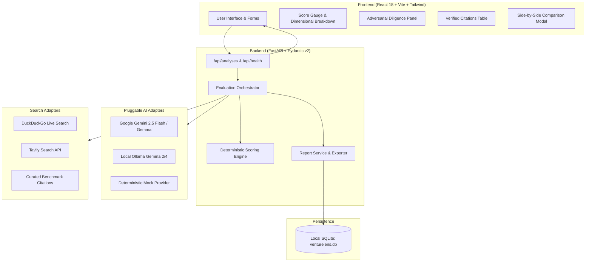

# VentureLens

> **Turn startup ideas into evidence-backed decisions.**

VentureLens is an open-source, evidence-backed startup feasibility and diligence platform. Unlike generic chatbots that merely generate polite advice, VentureLens combines real-world competitor discovery, transparent mathematical criteria scoring, and an adversarial investor red-team to stress-test weak assumptions before founders spend capital.

---

## 1. Problem Statement

Founders, student entrepreneurs, and hackathon teams frequently build products based on unvalidated assumptions, opaque market advice, and confirmation bias. Generic AI chatbots exacerbate this problem by acting as agreeable cheerleaders—failing to challenge flawed unit economics, overlooking entrenched incumbents, or hallucinating market statistics.

Entrepreneurs need an objective diligence engine that:
1. Conducts genuine competitor and market discovery.
2. Distinguishes verified external citations from founder hypotheses.
3. Challenges assumptions with an adversarial venture capitalist perspective.
4. Produces transparent, explainable feasibility scores with documented weights.
5. Prescribes concrete, inexpensive validation experiments to de-risk ideas before code is written.

---

## 2. Proposed Solution

VentureLens implements an automated 5-stage diligence pipeline:

```
[Startup Submission]
        │
        ▼
[Stage 1: Parameter Normalization & Domain Extraction]
        │
        ▼
[Stage 2: Live Web Evidence & Competitor Discovery (DuckDuckGo / Tavily)]
        │
        ▼
[Stage 3: Deterministic Scoring across 5 Feasibility Dimensions]
        │
        ▼
[Stage 4: Adversarial Investor Diligence (Harsh GP Red-Team & Pre-Mortem)]
        │
        ▼
[Stage 5: Citation Reconciliation & Actionable Experiment Generation]
        │
        ▼
[Saved Reports & Interactive Dashboard with Markdown/JSON Export]
```

---

## 3. Key Differentiators

- **Anti-Hallucination Evidence Record:** Every competitor and market claim is cross-referenced with retrieved web sources. The system explicitly tags records as `VERIFIED_SOURCE`, `DERIVED_ESTIMATE`, or `UNVERIFIED_HYPOTHESIS`.
- **Adversarial Red-Team Diligence:** A simulated General Partner red-teams the venture, identifying structural blindspots, CAC traps, incumbent retaliation threats, and an 18-month pre-mortem failure mode.
- **Explainable Composite Index:** Feasibility scores (0-100) are computed deterministically:
  $$\text{Score} = (0.20 \times \text{Problem}) + (0.25 \times \text{Market}) + (0.20 \times \text{Defensibility}) + (0.20 \times \text{Business}) + (0.15 \times \text{Technical}) - \text{Penalties}$$
- **Zero-Key Hackathon Demo Mode:** Runs immediately out of the box with deterministic mock evaluation mode and free web search, or unlocks live Google Gemini 2.5 Flash / Gemma inference with an API key.

---

## 4. Architecture

### System Architecture Diagram



---

## 5. Technology Stack

| Layer | Technology | Rationale |
|---|---|---|
| **Frontend** | React 18, Vite 8, TypeScript | Instant HMR, type safety, sub-second production builds |
| **Styling** | Tailwind CSS v4, Lucide React | Modern dark-slate SaaS design system, responsive UI |
| **Backend** | Python 3.12, FastAPI, Pydantic v2 | High performance, automatic OpenAPI documentation, schema validation |
| **Database** | SQLite via SQLAlchemy 2.0 ORM | Zero-configuration, zero-cost persistent local storage |
| **AI Inference** | Google Gemini 2.5 Flash / Gemma / Ollama / Mock | Pluggable provider adapter with graceful fallback |
| **Market Search** | DuckDuckGo / Tavily / Mock Evidence | Free web search index without mandatory API keys |
| **Testing** | pytest, pytest-asyncio, FastAPI TestClient | Deterministic automated unit and integration test suite |

---

## 6. Prerequisites

- **Python:** 3.10, 3.11, or 3.12 (`python --version`)
- **Node.js:** v18.0 or higher (`node --version`)
- **Git:** (`git --version`)

---

## 7. Installation & Quick Start

### Step 1: Clone the Repository
```bash
git clone https://github.com/your-username/venturelens.git
cd venturelens
```

### Step 2: Configure Environment Variables
```bash
# Windows PowerShell:
Copy-Item .env.example .env

# macOS / Linux:
cp .env.example .env
```

### Step 3: Setup Backend Virtual Environment
```powershell
# Windows PowerShell:
python -m venv .venv
.\.venv\Scripts\Activate.ps1
pip install -r backend\requirements.txt

# macOS / Linux:
python3 -m venv .venv
source .venv/bin/activate
pip install -r backend/requirements.txt
```

### Step 4: Install Frontend Dependencies
```bash
cd frontend
npm install
cd ..
```

---

## 8. Running the Application

### Terminal 1: Start Backend (FastAPI)
```powershell
# From project root:
.\.venv\Scripts\Activate.ps1
$env:PYTHONPATH = "backend"
uvicorn app.main:app --reload --port 8000
```
- Backend API: `http://localhost:8000`
- Interactive OpenAPI Docs: `http://localhost:8000/docs`
- Health Endpoint: `http://localhost:8000/api/health`

### Terminal 2: Start Frontend (Vite)
```bash
cd frontend
npm run dev
```
- Frontend Web UI: `http://localhost:5173`

---

## 9. API Keys & AI Provider Configuration

By default, VentureLens runs in **Deterministic Mock Mode** with live DuckDuckGo web search. It works 100% offline or without API keys for testing.

To enable live Google Gemini or Gemma inference:

1. Visit [Google AI Studio](https://aistudio.google.com/app/apikey).
2. Generate a free Gemini API key.
3. Open your `.env` file and set:
   ```env
   AI_PROVIDER=gemini
   GEMINI_API_KEY=your_actual_api_key_here
   GEMINI_MODEL=gemini-2.5-flash
   ```
4. Restart the backend server. The UI status pill will switch from `Demo Mock Mode` to `Live AI: gemini-2.5-flash`.

---

## 10. Running Automated Tests

Run the complete backend test suite:
```powershell
# Windows PowerShell:
$env:PYTHONPATH = "backend"
.\.venv\Scripts\pytest.exe backend\tests -v

# macOS / Linux:
PYTHONPATH=backend pytest backend/tests -v
```

Verify the frontend build:
```bash
cd frontend
npm run build
```

---

## 11. Security & Privacy

- **Server-Side Secret Isolation:** API keys are never exposed in frontend code bundles or transmitted to clients.
- **Untrusted Input Sanitization:** Retrieved web search HTML and startup submissions are treated as untrusted text. No shell execution or dynamic `eval` is permitted.
- **Local Persistence:** Analyses are stored in a local SQLite file (`venturelens.db`) and are never sent to third-party model training pipelines.

---

## 12. License

This project is licensed under the **Apache License, Version 2.0**. See the [LICENSE](LICENSE) file for details.
